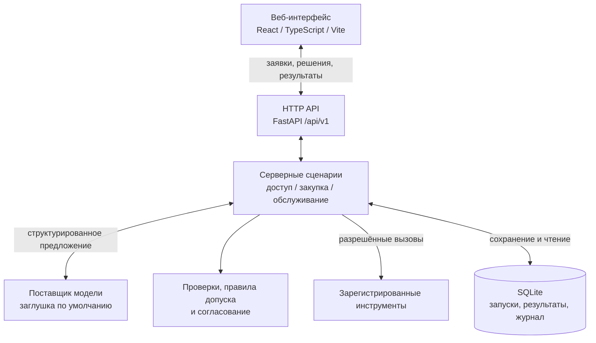
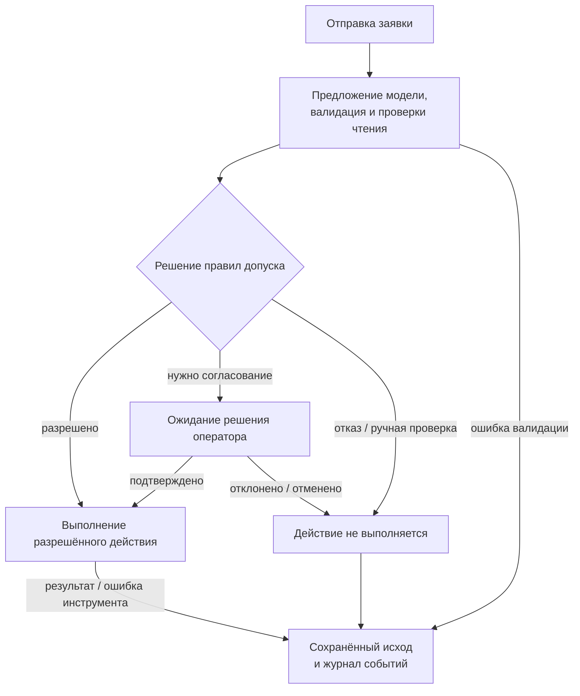

<div align="center">

# Enterprise AI Tool Gateway

**Локальный шлюз AI-инструментов: проверка предложенных действий, согласование оператором и журнал выполнения.**


[Демонстрация](#демонстрация) · [Быстрый старт](#быстрый-старт) · [Архитектура](#как-устроен-gateway)

</div>

## Демонстрация

Около двух минут: три реализованных сценария — доступ к системе, закупка и обслуживание — в русском интерфейсе Gateway.

[Смотреть видео](https://github.com/user-attachments/assets/d8f6e8f7-d521-42de-986b-02f59fa2bdbc)

**Содержание**

- [Зачем нужен Gateway](#зачем-нужен-gateway)
- [Возможности](#возможности)
- [Скриншоты](#скриншоты)
- [Как устроен Gateway](#как-устроен-gateway)
- [Быстрый старт](#быстрый-старт)
- [Проверки](#проверки)
- [Ограничения](#ограничения)
- [Статус](#статус)
- [Документация](#документация)

---

## Зачем нужен Gateway

Enterprise AI Tool Gateway показывает, как отделить предложение языковой модели от разрешения выполнить действие. Модель возвращает структурированное предложение; сервер проверяет его, обращается к зарегистрированным инструментам, применяет правила допуска и при необходимости запрашивает решение оператора. Ход обработки и результат сохраняются для последующего просмотра.

Например, заявка на закупку услуг стоимостью 1500 USD проходит проверки и останавливается до согласования. После подтверждения сервер создаёт синтетический черновик заявки; при отклонении черновик не создаётся. Оператор видит состояние запуска, вызовы инструментов и журнал событий.

Это демонстрационный прототип с искусственными данными. Обычный локальный запуск использует заглушку поставщика модели; подключение GigaChat вынесено в отдельный ручной сценарий.

## Возможности

| Сценарий | Что проверяет и показывает |
| --- | --- |
| Доступ к системе — `ACCESS_REQUEST` | Заявка сотрудника, проверки доступа, правила допуска и синтетический черновик |
| Закупка — `PROCUREMENT_REQUEST` | Проверки закупки, согласование действия и синтетический черновик заявки |
| Обслуживание — `MAINTENANCE_REQUEST` | Проверки оборудования и риска, безопасный исход либо передача на ручную проверку |

Общие механизмы:

- проверка структуры предложения модели, типа заявки, предметного шаблона и допустимых инструментов;
- согласование действий, меняющих состояние, с подтверждением, отклонением или отменой;
- карточка запуска со связанными вызовами инструментов, согласованиями и событиями;
- сохранение состояния в SQLite и маскирование чувствительных полей в ответах API;
- веб-интерфейс на русском и английском языках;
- набор из 21 детерминированного проверочного случая для поведения API.

Инженерный акцент проекта — разделение ответственности модели, серверной обработки, инструментов и интерфейса. Сервер принимает решения о допуске и хранит состояние, а интерфейс отправляет заявки и отображает полученные через API результаты.

## Скриншоты

Кадры сняты в английском интерфейсе; видео выше — в русском. Оба языка доступны в приложении.

<details>
<summary><strong>Обзорная панель</strong></summary>

Состояние API, демонстрационный режим, доступные сценарии и известные текущему браузеру запуски.

<p align="center">
  
</p>

</details>

<details>
<summary><strong>Отправка заявки</strong></summary>

Форма заявки на закупку и её отправка на серверную обработку.

<p align="center">
  
</p>

</details>

<details>
<summary><strong>Карточка запуска</strong></summary>

Итог обработки, сведения о сценарии и переходы к связанным вызовам инструментов, согласованиям и событиям.

<p align="center">
  
</p>

</details>

<details>
<summary><strong>Ручная проверка</strong></summary>

Контролируемый исход для заявки, которой требуется ручная проверка.

<p align="center">
  
</p>

</details>

<details>
<summary><strong>Настройки и состояние API</strong></summary>

Параметры подключения к API и сведения о локальном демонстрационном режиме.

<p align="center">
  
</p>

</details>

## Как устроен Gateway

### Компоненты и ответственность



Предложение модели считается недоверенным вводом. Сервер проверяет его и управляет выполнением; интерфейс получает только предназначенные для отображения данные через `/api/v1`.

### Путь заявки



Проверки, которые только читают данные, могут выполняться до согласования. Изменяющий состояние инструмент создаёт синтетический черновик только после разрешения по правилам допуска или обязательного согласования. Полная последовательность и остальные возможные исходы описаны в [архитектуре](docs/ARCHITECTURE.md) и [описании API](docs/API_AND_EVALS.md).

## Быстрый старт

Нужны **Python ≥3.14**, **uv**, **Node.js и npm**. Команды выполняются из корня репозитория, если не указано иное. Для демонстрации с заглушкой ключи поставщиков моделей не требуются.

После получения репозитория установите зависимости веб-интерфейса:

```bash
cd frontend
npm install
cd ..
```

### Запуск в Windows

```text
run_demo.cmd
```

Программа запуска поднимает сервер и веб-интерфейс, проверяет их готовность и открывает обзорную панель. Логи обоих сервисов видны в одном окне PowerShell и сохраняются в `.runtime/logs/<instance-id>/`.

Нажмите `Ctrl+C` для штатной остановки. Закрытие окна также завершает процессы, запущенные этой программой; `Q` — дополнительный способ остановки. Уже готовые сервисы переиспользуются и сохраняют своего владельца. Для явной остановки старых экземпляров с проверенным владельцем предусмотрен `scripts/demo/stop_demo.ps1`. Зависимости npm устанавливаются отдельно.

### Запуск в двух терминалах

Сервер — из корня репозитория:

```bash
uv run uvicorn enterprise_ai_tool_gateway.api.http.app:app --reload
```

Веб-интерфейс — во втором терминале:

```bash
cd frontend
npm run dev -- --host 127.0.0.1 --port 5173
```

Адреса интерфейса, проверки готовности и доступных возможностей:

```text
http://127.0.0.1:5173/dashboard
http://127.0.0.1:8000/api/v1/health
http://127.0.0.1:8000/api/v1/capabilities
```

Корневой адрес сервера `/` может возвращать 404: API доступен через `/api/v1`, а веб-интерфейс обслуживает Vite.

Для первого показа используйте проверенные значения из [пошагового руководства](docs/DEMO_WALKTHROUGH.md). Демонстрационные инструменты работают с ограниченным набором искусственных данных; произвольный текст не гарантирует тот же путь обработки.

## Проверки

Серверная часть:

```bash
uv run pytest
uv run ruff check .
uv run pyright
uv run python scripts/run_eval.py
uv run python scripts/run_eval.py --format json
```

Веб-интерфейс:

```bash
cd frontend
npm run typecheck
npm run build
```

Обычные проверки используют детерминированные заглушки поставщика модели и не требуют реальных ключей. Ожидаемые исходы 21 проверочного случая перечислены в [документе об API и проверках](docs/API_AND_EVALS.md).

## Ограничения

- Локальный демонстрационный прототип с синтетическими данными и действиями.
- По умолчанию используется заглушка модели. GigaChat проверяется отдельным ручным сценарием; переключателя моделей в интерфейсе нет.
- Аутентификация, ролевая модель доступа и изоляция организаций не реализованы.
- Реальные корпоративные системы и необратимые внешние действия не подключены.
- Развёртывание, хостинг, платежи и подготовка защиты для промышленной эксплуатации не входят в текущий объём.
- Список известных запусков хранится в текущем браузере; общего серверного списка запусков нет.

## Статус

Версия `0.1.0`: текущий демонстрационный объём завершён, дальнейшая функциональная разработка заморожена. Возможности и ограничения описаны по существующей реализации; будущие идеи остаются отложенными.

Текущее описание реализации и её границ находится в публичных документах в `docs/`.

## Документация

| Документ | Содержание |
| --- | --- |
| [Контекст проекта](docs/PROJECT_CONTEXT.md) | Назначение, реализованные сценарии и границы прототипа |
| [Архитектура](docs/ARCHITECTURE.md) | Слои, жизненный цикл заявки, инструменты, согласование, хранение и журнал |
| [Карта проекта](docs/PROJECT_MAP.md) | Структура репозитория, модули и точки входа |
| [API и проверки](docs/API_AND_EVALS.md) | Методы API, контролируемые исходы, маскирование и 21 проверочный случай |
| [Пошаговая демонстрация](docs/DEMO_WALKTHROUGH.md) | Запуск и прохождение трёх сценариев через интерфейс |
| [Руководство по разработке](docs/DEVELOPMENT_GUIDE.md) | Окружение, команды, проверка запуска и диагностика |
| [Политика поставщиков моделей](docs/LLM_PROVIDER_POLICY.md) | Заглушка, ручной путь GigaChat и правила обработки предложений модели |
| [Проверочная ведомость разработки](docs/DEVELOPMENT_CHECKLIST.md) | Проверки при изменениях и сохранение границ проекта |
