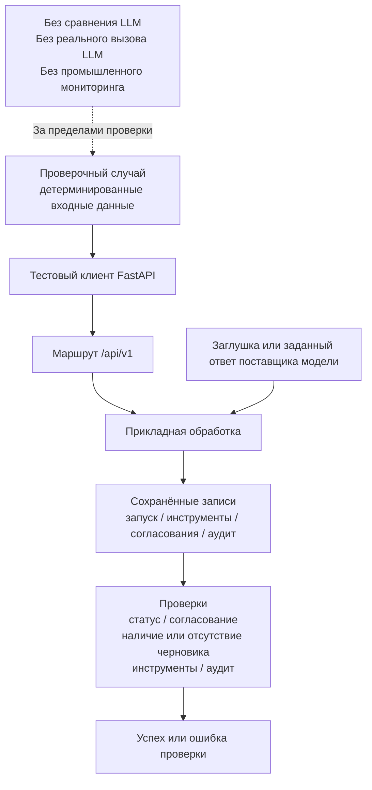

# API и приёмочные проверки

## 1. Назначение

API предоставляет локальный демонстрационный интерфейс шлюза контролируемого выполнения инструментов LLM. Он принимает запросы для сценариев на синтетических данных, передаёт обработку прикладным компонентам серверной части, возвращает контролируемые результаты запусков и позволяет прочитать вызовы инструментов, согласования и события аудита отдельного запуска.

Набор приёмочных проверок подтверждает детерминированное поведение этого жизненного цикла через публичный API. Это проверка серверного управления выполнением, а не сравнение моделей LLM, оценка качества поставщика модели, мониторинг промышленной системы или тест реального внешнего сервиса.

## 2. Принципы проектирования API

* `/api/v1` — публичный API локального демонстрационного приложения.
* Маршруты API являются входными адаптерами: преобразуют DTO запросов, вызывают прикладные компоненты или методы чтения репозитория и возвращают публичные DTO ответов.
* Прикладные компоненты управляют сценарием: обращениями к поставщику модели, серверной валидацией, выполнением инструментов, проверками политики выполнения, согласованиями, сохранением данных и аудитом.
* Результат обработки выражается контролируемым статусом запуска. Корректный запрос API может вернуть HTTP 200 с остановкой по политике шлюза, например `REJECTED`, `NEEDS_MANUAL_REVIEW` или `FAILED_VALIDATION`.
* По умолчанию используется детерминированная заглушка `mock`.
* Выбор поставщика LLM и модели отключён. DTO отправки сценариев отклоняют дополнительные поля такого выбора.

## 3. Состояние API и доступные возможности

| Метод | Путь | Назначение |
| --- | --- | --- |
| `GET` | `/api/v1/health` | Проверить доступность локального API. |
| `GET` | `/api/v1/capabilities` | Получить сведения о реализованных демонстрационных сценариях и возможностях поставщика модели. |

`GET /api/v1/health` возвращает:

```json
{"status": "ok"}
```

`GET /api/v1/capabilities` раскрывает:

| Поле | Текущее значение |
| --- | --- |
| `workflows` | `ACCESS_REQUEST`, `PROCUREMENT_REQUEST`, `MAINTENANCE_REQUEST` |
| `approval_modes` | `AUTO_APPROVE`, `HIGH_RISK_ONLY`, `ALWAYS_REQUIRE` |
| `provider_mode` | `mock` |
| `model_selection.enabled` | `false` |
| `model_selection.active_profile` | `mock` |
| `model_selection.available_profiles` | `["mock"]` |

Ответ о возможностях намеренно не представляет GigaChat, OpenRouter, YandexGPT или каталог поставщиков моделей как доступные для выбора варианты API.

## 4. Отправка сценариев

Все маршруты отправки возвращают `WorkflowResultResponse`, содержащий:

* `run`;
* `final_summary`;
* `requires_approval`;
* `approval`;
* `tool_calls`;
* `audit_events`.

| Метод | Путь | Назначение | Проверки и контролируемые действия |
| --- | --- | --- | --- |
| `POST` | `/api/v1/access-requests` | Отправить демонстрационный запрос доступа. | Проверки сотрудника, системы и правил доступа; серверная валидация инструментов; допуск по политике выполнения и согласование доступа высокого риска. |
| `POST` | `/api/v1/procurement-requests` | Отправить демонстрационный запрос на закупку. | Проверки инициатора, поставщика, каталога, бюджета и дубликатов; создание черновика закупки и согласование расходов повышенного риска. |
| `POST` | `/api/v1/maintenance-requests` | Отправить демонстрационную заявку на обслуживание. | Проверки инициатора, актива, критичности и безопасности; валидация допустимой критичности; создание черновика заказ-наряда и согласование высокой критичности. |

Для всех трёх маршрутов предусмотрены результаты `COMPLETED`, `WAITING_FOR_APPROVAL`, `NEEDS_USER_INPUT`, `NEEDS_MANUAL_REVIEW`, `REJECTED` и `FAILED_VALIDATION`. Ошибки на границах поставщика модели или инструмента завершаются контролируемыми статусами `FAILED_PROVIDER` или `FAILED_TOOL`.

Краткий пример запроса доступа:

```json
{
  "user_id": "user-1",
  "request_text": "Need access to CRM.",
  "employee_id": "emp-001",
  "system_id": "crm",
  "access_level": "READ",
  "duration_days": 30,
  "approval_mode": "HIGH_RISK_ONLY"
}
```

У каждого сценария своя схема отправки. Поля `provider`, `model` и подобные параметры выбора модели не принимаются.

Демонстрационный контракт закупки принимает только валюту `USD`. Иное значение отклоняется при валидации запроса с HTTP 422 до запуска сценария.

## 5. Принятие решения по согласованию

| Метод | Путь | Назначение |
| --- | --- | --- |
| `POST` | `/api/v1/approvals/{approval_id}/resolve` | Принять решение по согласованию для запуска, ожидающего разрешения. |

Тело запроса:

```json
{
  "run_id": "<run uuid>",
  "status": "APPROVED",
  "decided_by": "manager-001",
  "decision_comment": "Approved for demo."
}
```

Поддерживаемые окончательные решения:

| Решение | Действие |
| --- | --- |
| `APPROVED` | Возобновляет ожидающий запуск и выполняет отложенный инструмент создания черновика через разрешённую серверную границу. |
| `REJECTED` | Отклоняет запуск без создания черновика. |
| `CANCELLED` | Отклоняет запуск без создания черновика. |

`PENDING` не является решением и отклоняется схемой запроса с HTTP 422. Поле `decided_by` обязательно: пустая строка или строка из пробелов также приводит к HTTP 422. Это демонстрационная подпись принявшего решение, а не подтверждённая аутентификацией личность или проверка RBAC.

При обязательном согласовании действие создания черновика не запускается и черновик не появляется до принятия решения. Отклонение или отмена согласования не создаёт черновик. Условное обновление репозитория атомарно предоставляет право перехода из `PENDING` в окончательный статус одному обработчику. Конкурирующий, повторный, устаревший запрос или запрос с чужим `run_id`, которому этот переход недоступен, получает HTTP `409` с `detail.code == "state_conflict"`. Это происходит до повторного выполнения инструмента действия, перезаписи запуска, перезаписи окончательного состояния `ToolCall` или создания противоречивого итогового события аудита.

Режим `AUTO_APPROVE` сохраняет минимальные ограничения безопасности: он не обходит контроль изменяющих состояние действий высокого и критического риска или действий, по умолчанию требующих согласования. Действия высокого риска и действия с обязательным согласованием по умолчанию всё равно требуют разрешения; критический риск направляется на ручную проверку.

## 6. Чтение данных запуска

| Метод | Путь | Назначение |
| --- | --- | --- |
| `GET` | `/api/v1/runs/{run_id}` | Прочитать сведения о запуске вместе с согласованиями, вызовами инструментов и событиями аудита. |
| `GET` | `/api/v1/runs/{run_id}/tool-calls` | Прочитать вызовы инструментов одного запуска. |
| `GET` | `/api/v1/runs/{run_id}/approvals` | Прочитать согласования одного запуска. |
| `GET` | `/api/v1/runs/{run_id}/audit-events` | Прочитать события аудита одного запуска. |

Чтение ограничено выбранным запуском. Сервер пока не предоставляет общий список запусков, общую очередь согласований и глобальный поиск аудита. Индекс известных запусков в браузере нужен для удобства демонстрационной сессии; он не является серверным источником истины и не заменяет сохранённые записи отдельных запусков.

Неизвестный `run_id` возвращает HTTP 404 как при чтении сведений о запуске, так и на маршрутах связанных записей.

## 7. Контролируемые результаты и ошибки HTTP

Контролируемые статусы принадлежат серверной части и описывают решение шлюза после обработки корректного запроса.

| Статус запуска | Значение |
| --- | --- |
| `COMPLETED` | Запуск достиг допустимого конечного состояния, обычно с демонстрационным черновиком. |
| `WAITING_FOR_APPROVAL` | Обязательное согласование ожидает решения; действие создания черновика ещё не выполнено. |
| `NEEDS_USER_INPUT` | Не хватает обязательных полей запроса или уточнений. |
| `NEEDS_MANUAL_REVIEW` | Политика выполнения или проверки синтетических данных требуют ручной проверки. |
| `REJECTED` | Политика выполнения или решение по согласованию отклонили запуск. |
| `FAILED_VALIDATION` | Ответ поставщика модели, тип запроса, доменный шаблон или предложенные имена инструментов не прошли серверную валидацию. |
| `FAILED_TOOL` | Вызов инструмента или действие создания черновика завершились контролируемой ошибкой. |
| `FAILED_PROVIDER` | Обращение к поставщику модели завершилось контролируемой ошибкой. |

Эти статусы могут возвращаться с HTTP 200: запрос API был корректен, а шлюз успешно обработал его, в том числе остановив дальнейшее выполнение.

Ошибки HTTP обозначают ошибки уровня API:

| Статус HTTP | Использование |
| --- | --- |
| `422` | Некорректное тело запроса, в том числе запрещённые дополнительные поля, валюта закупки не `USD`, пустой `decided_by` или `PENDING` в качестве решения по согласованию. |
| `404` | Запуск или согласование не найдены. |
| `409` | Конфликт состояния: например, несоответствие запуска и согласования, запуск уже не ожидает решения или решение принимается повторно. |
| `500` | Непредвиденная внутренняя ошибка API с безопасным общим сообщением. |

## 8. Публичные данные и маскирование

Ответы API используют безопасное публичное представление внутренних записей:

* во входных и выходных данных инструментов чувствительные значения маскируются перед возвратом через API;
* свободные текстовые поля согласования `summary`, `reason`, `decided_by` и `decision_comment` также проходят такую обработку;
* данные событий аудита проходят рекурсивное маскирование до сохранения и затем доступны в пределах одного запуска;
* проверяются чувствительные ключи и значения с достаточно надёжными признаками секретов: токены, пароли, секреты, ключи API, авторизационные данные и присваивания учётных данных в кавычках или сериализованном виде;
* сохранённые записи могут содержать внутренние сведения, не раскрываемые публичными DTO;
* обработка ограничена заданными маркерами и шаблонами значений. Обычный пояснительный текст с двоеточием сам по себе не считается секретом. Это не полноценная система безопасности, защиты персональных данных, DLP или классификации информации.

## 9. Как устроены приёмочные проверки

`scripts/run_eval.py` запускает детерминированный набор приёмочных проверок API. Для каждого случая создаются приложение FastAPI внутри процесса и отдельная временная база SQLite, а ответы поставщика модели подменяются детерминированной заглушкой или заданным ответом. Проверки обращаются к публичным маршрутам API.

Проверяется жизненный цикл шлюза:

* маршруты отправки возвращают ожидаемые контролируемые статусы;
* случаи с обязательным согласованием не создают черновик до разрешения;
* принятие решения приводит к ожидаемому конечному статусу;
* повторное решение вызывает конфликт;
* маршруты чтения запуска возвращают согласованные связанные записи;
* присутствуют ожидаемые события аудита и коды причин;
* итоговые сводки присутствуют и не содержат очевидных опасных маркеров;
* при ошибке валидации вызовы инструментов не сохраняются.

Реальные поставщики моделей, внешняя сеть и корпоративные системы не вызываются.



## 10. Матрица приёмочных проверок

Текущий детерминированный набор содержит 21 случай. Таблица описывает ожидаемые результаты, а не отчёт о последнем запуске проверок.

| Сценарий | ID проверки | Начальный статус | Решение | Конечный статус | Что проверяется |
| --- | --- | --- | --- | --- | --- |
| Доступ | `access_completed` | `COMPLETED` | Нет | `COMPLETED` | Обычный запрос доступа создаёт демонстрационный черновик. |
| Доступ | `access_approval_approved` | `WAITING_FOR_APPROVAL` | `APPROVED` | `COMPLETED` | Доступ высокого риска ожидает решения и завершается после согласования. |
| Доступ | `access_approval_rejected` | `WAITING_FOR_APPROVAL` | `REJECTED` | `REJECTED` | Доступ высокого риска отклоняется после отказа в согласовании. |
| Доступ | `access_missing_input` | `NEEDS_USER_INPUT` | Нет | `NEEDS_USER_INPUT` | Нет данных сотрудника или срока: требуются данные пользователя. |
| Доступ | `access_manual_review_unknown_system` | `NEEDS_MANUAL_REVIEW` | Нет | `NEEDS_MANUAL_REVIEW` | Неизвестная система требует ручной проверки. |
| Доступ | `access_rejected_forbidden` | `REJECTED` | Нет | `REJECTED` | Запрещённый административный доступ стажёра отклоняется без черновика. |
| Доступ | `access_failed_validation_unknown_tool` | `FAILED_VALIDATION` | Нет | `FAILED_VALIDATION` | Предложение неизвестного инструмента доступа не проходит серверную валидацию. |
| Закупка | `procurement_completed` | `COMPLETED` | Нет | `COMPLETED` | Обычный запрос на закупку создаёт демонстрационный черновик. |
| Закупка | `procurement_approval_approved` | `WAITING_FOR_APPROVAL` | `APPROVED` | `COMPLETED` | Закупка на большую сумму ожидает решения и завершается после согласования. |
| Закупка | `procurement_approval_rejected` | `WAITING_FOR_APPROVAL` | `REJECTED` | `REJECTED` | Закупка на большую сумму отклоняется после отказа в согласовании. |
| Закупка | `procurement_missing_input` | `NEEDS_USER_INPUT` | Нет | `NEEDS_USER_INPUT` | Нет данных инициатора, позиции или количества: требуются данные пользователя. |
| Закупка | `procurement_manual_review_total_mismatch_or_budget` | `NEEDS_MANUAL_REVIEW` | Нет | `NEEDS_MANUAL_REVIEW` | Несоответствие суммы или проблема бюджета требуют ручной проверки. |
| Закупка | `procurement_rejected_blocked_vendor_or_restricted_item` | `REJECTED` | Нет | `REJECTED` | Заблокированный поставщик или запрещённая позиция отклоняются без черновика. |
| Закупка | `procurement_failed_validation_unknown_tool` | `FAILED_VALIDATION` | Нет | `FAILED_VALIDATION` | Предложение неизвестного инструмента закупки не проходит серверную валидацию. |
| Обслуживание | `maintenance_completed` | `COMPLETED` | Нет | `COMPLETED` | Обычная заявка на обслуживание создаёт демонстрационный черновик. |
| Обслуживание | `maintenance_approval_approved` | `WAITING_FOR_APPROVAL` | `APPROVED` | `COMPLETED` | Высокая критичность требует ожидания и завершается после согласования. |
| Обслуживание | `maintenance_approval_rejected` | `WAITING_FOR_APPROVAL` | `REJECTED` | `REJECTED` | Заявка высокой критичности отклоняется после отказа в согласовании. |
| Обслуживание | `maintenance_missing_input` | `NEEDS_USER_INPUT` | Нет | `NEEDS_USER_INPUT` | Нет данных инициатора или актива: требуются данные пользователя. |
| Обслуживание | `maintenance_manual_review_safety_or_critical_asset` | `NEEDS_MANUAL_REVIEW` | Нет | `NEEDS_MANUAL_REVIEW` | Угроза безопасности или критически важный актив требуют ручной проверки. |
| Обслуживание | `maintenance_rejected_forbidden` | `REJECTED` | Нет | `REJECTED` | Запрещённая инструкция обслуживания отклоняется без черновика. |
| Обслуживание | `maintenance_failed_validation_unknown_tool` | `FAILED_VALIDATION` | Нет | `FAILED_VALIDATION` | Предложение неизвестного инструмента обслуживания не проходит серверную валидацию. |

## 11. Запуск проверок

Детерминированный набор приёмочных проверок:

```bash
uv run python scripts/run_eval.py
uv run python scripts/run_eval.py --format json
```

Более широкие проверки серверной части:

```bash
uv run pytest
uv run ruff check .
uv run pyright
git diff --check
```

Веб-интерфейс проверяется отдельно от серверной части на Python. Если меняется код веб-интерфейса, выполните:

```bash
cd frontend
npm run typecheck
npm run build
```

## 12. Чего приёмочные проверки не доказывают

Набор проверок не подтверждает:

* безопасность промышленной эксплуатации;
* качество реального поставщика модели;
* поведение реальных корпоративных интеграций;
* аутентификацию, RBAC или изоляцию арендаторов;
* масштабируемость или поведение под нагрузкой;
* полное сквозное тестирование интерфейса;
* качество модели в сравнительных испытаниях;
* готовность промышленного мониторинга.

## 13. Связанные документы

* [Контекст проекта](PROJECT_CONTEXT.md) — границы прототипа, реализованные сценарии, состояние API и интерфейса, явные ограничения.
* [Архитектура](ARCHITECTURE.md) — устройство системы, жизненный цикл запроса, границы ответственности, согласования, ошибки и ограничения.
* [Карта проекта](PROJECT_MAP.md) — структура репозитория, владельцы пакетов, точки входа API и проверок.
* [Демонстрационный сценарий](DEMO_WALKTHROUGH.md) — локальный показ серверной части, интерфейса и приёмочных проверок.
* [Руководство разработчика](DEVELOPMENT_GUIDE.md) — установка, проверки и порядок безопасной разработки.
