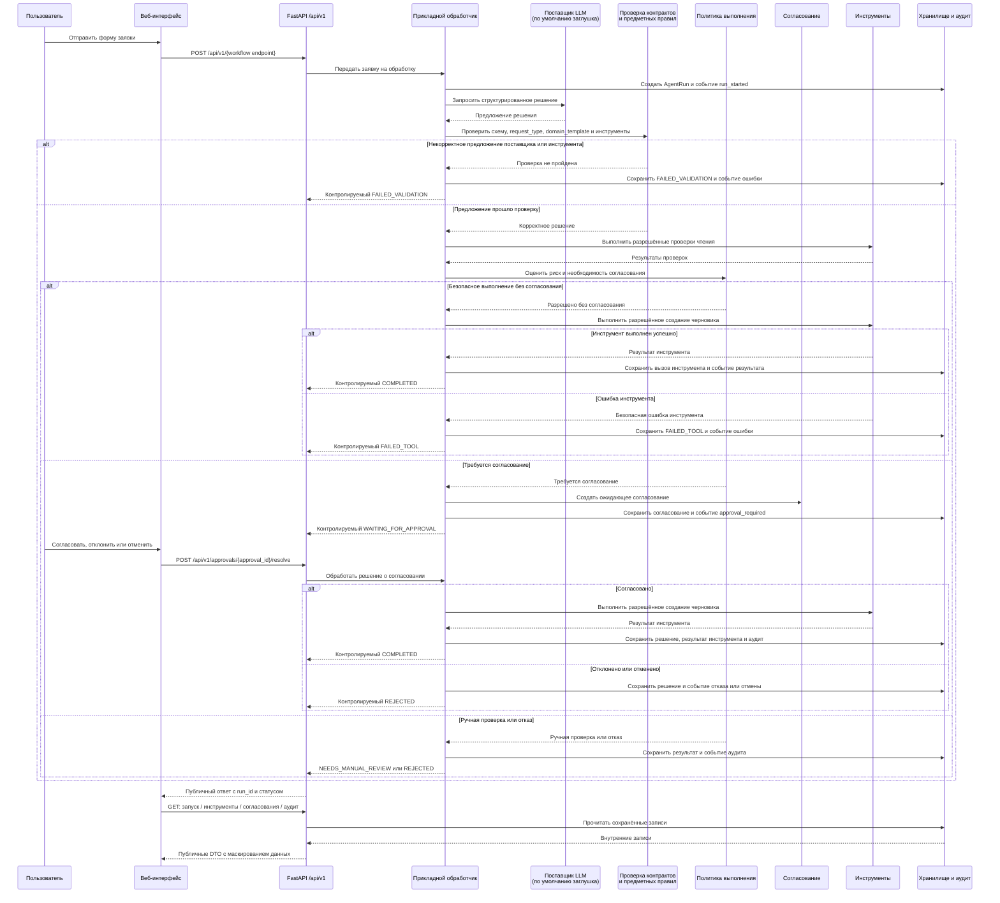

# Архитектура

## 1. Архитектурный тезис

Enterprise AI Tool Gateway — шлюз контролируемого выполнения инструментов LLM для локальных демонстрационных сценариев. Модель предлагает структурированное решение, которое по умолчанию считается недоверенным. Сервер проверяет ответ поставщика LLM, тип запроса, предметный шаблон и имена предложенных инструментов, применяет политику выполнения и при необходимости требует согласование. Инструменты выполняются только через зарегистрированные серверные интерфейсы; события аудита и остальные записи сохраняются с привязкой к запуску.

LLM не выполняет инструменты, не согласует действия, не записывает данные в хранилище и не управляет состоянием сценария. За эти действия отвечает серверная логика обработки.

## 2. Высокоуровневый системный поток

```mermaid
flowchart LR
    Frontend["Веб-интерфейс<br/>React/Vite"]
    API["FastAPI /api/v1<br/>HTTP-адаптер"]
    Runtime["Обработка сценариев<br/>доступ / закупки / обслуживание"]
    Provider["Интерфейс поставщика LLM<br/>структурированное решение"]
    Validation["Серверная валидация<br/>схема, request_type, domain_template, инструменты"]
    ReadTools["Инструменты чтения<br/>зарегистрированные проверки"]
    Policy["Политика выполнения<br/>решение об изменяющем действии"]
    Approval["Согласование<br/>по требованию политики"]
    ActionTools["Инструменты изменения<br/>разрешённое создание черновика"]
    Audit["Аудит<br/>события с маскированием данных"]
    DB[("Хранилище SQLite<br/>асинхронный SQLAlchemy")]
    Readback["Чтение через API<br/>записи конкретного запуска"]
    Display["Отображение результата<br/>локальная консоль оператора"]

    Frontend --> API --> Runtime --> Provider --> Validation
    Validation --> ReadTools --> Policy
    Policy -->|"разрешено"| ActionTools
    Policy -->|"нужно согласование"| Approval -->|"согласовано"| ActionTools
    Policy -->|"отказ / ручная проверка"| Audit
    Approval -->|"отклонено / отменено"| Audit
    ActionTools --> Audit
    Runtime --> DB
    Audit --> DB
    DB --> Readback --> Display
```

API и веб-интерфейс предназначены для локальной демонстрации. Серверный API принимает заявки и решения о согласовании, а методы чтения возвращают сведения о запуске, вызовах инструментов, согласованиях и событиях аудита. Результаты обработки выражаются статусами запуска; полномочия по управлению сценарием остаются на сервере.

## 3. Модель слоёв

Веб-клиент находится в `frontend/`. Это независимое приложение на React, TypeScript и Vite. Оно обращается к серверу через `frontend/src/api`, хранит локальный список известных браузеру запусков в `frontend/src/state` и содержит типизированный слой русских и английских текстов интерфейса в `frontend/src/i18n`.

API-адаптер находится в `src/enterprise_ai_tool_gateway/api/http`. Он отвечает за маршрутизацию FastAPI, DTO запросов и ответов, нормализацию ошибок, подключение зависимостей и преобразование DTO между API и прикладным слоем. Обработчики маршрутов остаются тонкими: они не выполняют инструменты, не оценивают политику, не принимают решения аудита и не управляют состоянием сценария.

Прикладные обработчики находятся в `application/`. Они координируют одну операцию обработки сценария `ACCESS_REQUEST`, `PROCUREMENT_REQUEST` или `MAINTENANCE_REQUEST`: создают запуски, обращаются к поставщику LLM, проверяют структурированные решения, выполняют зарегистрированные инструменты, применяют политику, создают согласования и обрабатывают решения по ним, сохраняют записи и собирают ответ.

Контракты находятся в `contracts/`. Они определяют общие перечисления и контракты Pydantic, включая `AgentRun`, `LLMDecision`, `ToolCall`, `Approval`, `AuditEvent`, типы запросов, предметные шаблоны, типы инструментов, режимы согласования и статусы запусков.

Слой поставщиков LLM находится в `llm/`. Он определяет интерфейс поставщика, безопасные ошибки, детерминированное поведение заглушки, разбор структурированного ответа и отдельный ручной путь работы с реальным поставщиком. Ответ поставщика должен пройти проверку по серверным контрактам до принятия прикладным обработчиком.

Слой политики находится в `policy/`. Он получает сформированный сервером запрос на оценку и возвращает решение: разрешить, запретить, потребовать согласование или ручную проверку. Этот слой не выполняет инструменты и не изменяет состояние сценария.

Инструменты находятся в `tools/` и пакетах отдельных сценариев: `access/`, `procurement/` и `maintenance_lite/`. Общий слой инструментов содержит `ToolRegistry`, `ToolDefinition` и `ToolExecutor`. Предметные пакеты регистрируют синтетические демонстрационные инструменты и их типизированные схемы.

Слой согласования находится в `approval/`. Он определяет требования к согласованию и окончательные решения. Прикладные обработчики сохраняют записи согласований и определяют влияние решений на запуск.

Слой аудита находится в `audit/`. Он создаёт контракты событий с замаскированными данными и рекурсивно маскирует содержимое. Сохранением этих событий занимается слой репозиториев.

Слой хранения находится в `db/`. Он использует асинхронный SQLAlchemy, локальный SQLite и фасад репозитория для уже проверенных записей шлюза. Репозиторий сохраняет факты, выбранные прикладными обработчиками; он не принимает решения политики и не определяет результат сценария.

Приёмочные проверки находятся в `evals/` и `scripts/run_eval.py`. Они проверяют API на детерминированных случаях с заглушками поставщиков.

## 4. Жизненный цикл запроса

Запуск создаётся до обращения к поставщику LLM. Затем решение поставщика сохраняется как запись `LLMDecision`, если оно представимо в ожидаемой схеме. Прикладная валидация отклоняет несовпадающие типы запросов, предметные шаблоны и неизвестные предложения инструментов до выполнения любого плана инструментов. Отсутствие обязательных предметных полей останавливает обработку со статусом `NEEDS_USER_INPUT`.

Инструменты чтения выполняются до окончательного решения о создании черновика изменяющим инструментом. Политика оценивает именно действие создания черновика. Если нужно согласование, обработчик создаёт ожидающее согласование и ожидающий вызов изменяющего инструмента, но не запускает его. Инструмент создания черновика выполняется только после прямого разрешения политики либо после положительного решения по ожидающему согласованию.

## 5. Граница выполнения инструментов

`ToolRegistry` — основной внутренний интерфейс регистрации инструментов. Он хранит именованные объекты `ToolDefinition` с именем, описанием, `ToolType`, моделями входа и выхода, уровнем риска, настройками обязательного согласования по умолчанию и обработчиком.

`ToolExecutor` проверяет входные данные по зарегистрированной модели Pydantic, блокирует инструменты, не относящиеся к чтению, если не передано `execution_authorized=True`, выполняет обработчик и проверяет результат по зарегистрированной модели выхода. Если обработчик инструмента выбрасывает исключение, исполнитель возвращает неуспешный результат с безопасным сообщением об ошибке. Вспомогательная логика прикладного слоя перехватывает ошибки реестра и валидации и сохраняет безопасные записи неуспешных вызовов.

Текущие значения `ToolType`: `READ_ONLY`, `STATE_CHANGING`, `APPROVAL` и `AUDIT`. Реализованные демонстрационные сценарии преимущественно используют синтетические проверки чтения и синтетические действия создания черновиков. Внешние инструменты для необратимых действий в корпоративных системах не реализованы.

Разрешённые имена инструментов определяются каждым обработчиком и реестром. Поставщик LLM только предлагает инструменты. Неизвестные инструменты, инструменты вне разрешённого списка сценария и отсутствующие в реестре инструменты приводят к ошибке валидации. Сервер не угадывает имена, не подбирает похожие и не исправляет их автоматически.

## 6. Граница согласования

Согласование обязательно, когда политика возвращает `REQUIRES_APPROVAL`. Политика по умолчанию требует его для изменяющих вызовов с высоким риском, инструментов с обязательным согласованием по умолчанию и режима `ALWAYS_REQUIRE`. Вызовы с критическим риском направляются на ручную проверку, а не согласуются автоматически.

Обязательный минимум контроля означает, что `AUTO_APPROVE` не обходит ограничения для изменяющих действий с высоким или критическим риском либо с обязательным согласованием по умолчанию. `AUTO_APPROVE` может разрешать изменяющие действия с низким или средним риском только после успешной серверной валидации и проверки политики.

При необходимости согласования обработчик сохраняет ожидающее согласование и вызов изменяющего инструмента со статусом `WAITING_FOR_APPROVAL`. Действие не запускается, и черновик не создаётся до обязательного разрешения.

Положительное решение возобновляет запуск и выполняет ожидающий вызов с явным разрешением. Отказ или отмена помечает ожидающий вызов как отклонённый, если он существует, переводит запуск в `REJECTED` и записывает события аудита. Валидация запроса требует непустой `decided_by`. Условное обновление в хранилище даёт ровно одному решению право перевести ожидающее согласование в окончательное состояние. Конкурирующее, повторное, устаревшее решение или решение без права на этот переход получает контролируемый `409 state_conflict` до выполнения изменяющего инструмента, изменения запуска, окончательной записи `ToolCall` или окончательных событий аудита со стороны проигравшего запроса.

## 7. Граница поставщика LLM

Поставщики создают структурированные решения, совместимые с `LLMDecisionPayload`. Решение содержит тип запроса, предметный шаблон, уверенность, уровень риска, признак согласования, отсутствующие поля, предложенные вызовы инструментов, понятное пользователю резюме и коды причин.

Сервер проверяет результат в два этапа. Сначала данные должны быть разобраны и пройти валидацию по контракту Pydantic. Затем выбранный прикладной обработчик проверяет смысловые ограничения: тип запроса должен соответствовать сценарию API, предметный шаблон — обработчику, а имена предложенных инструментов должны быть разрешены и зарегистрированы.

API по умолчанию использует детерминированные заглушки поставщиков. Метод возможностей сообщает `provider_mode` как `mock` и возвращает `model_selection.enabled = false`, `active_profile = "mock"` и `available_profiles = ["mock"]`.

Поддержка GigaChat и утилиты ручной проверки существуют, но проверка реального поставщика запускается только явно и вручную. Она не входит в стандартный путь API или веб-интерфейса и не должна выполняться в составе обычных тестов. Не реализованы OpenRouter, выбор YandexGPT во время работы, каталог поставщиков, резервная маршрутизация между ними или выбор модели в интерфейсе.

## 8. Граница аудита и маскирования данных

События аудита фиксируют значимые этапы жизненного цикла: создание запуска, выбор поставщика, валидацию решения, выполнение инструментов, проверки политики, запросы и решения согласования, ручную проверку, отказ, завершение и ошибки.

При создании событий их содержимое рекурсивно маскируется до сохранения. Публичное представление API также маскирует входные и выходные данные инструментов и свободные текстовые поля согласований, например `summary`, `reason`, `decided_by` и `decision_comment`.

Маскирование учитывает ключи и значения. Значения полей с ключами, похожими на секреты, и значения с уверенно распознаваемыми маркерами, включая присваивания учётных данных в кавычках или сериализованном виде, заменяются на `[REDACTED]`; длинные строки обрезаются. Обычный поясняющий текст с двоеточиями не считается учётными данными только из-за такой формы. Сохранённые внутренние записи могут содержать больше подробностей, чем публичные DTO API, особенно для содержимого инструментов и согласований.

Этот слой распознавания маркеров — ограниченная защитная граница локального прототипа. Он не является полноценной системой безопасности, защиты частной информации, DLP или классификации данных.

## 9. Модель хранения данных

Прототип использует локальный SQLite через асинхронный SQLAlchemy. Приложение API по умолчанию сохраняет данные в локальную базу SQLite и создаёт схему при запуске. Тесты и приёмочные проверки могут создавать изолированные временные базы SQLite.

Сохраняемые записи шлюза:

* `AgentRun`: общие сведения о запуске, текст запроса, режим согласования, текущий статус, выбранные тип запроса и предметный шаблон, риск, сведения о поставщике, итоговое резюме и безопасные поля ошибок.
* `LLMDecision`: проверенное решение поставщика, признак соответствия схеме, ошибки валидации и уверенность.
* `ToolCall`: каждый предложенный или выполненный вызов, тип инструмента, статус, входные и выходные данные, безопасное сообщение об ошибке и ссылка на согласование.
* `Approval`: ожидающее или окончательное состояние согласования, роль согласующего, резюме, причина и сведения о решении.
* `AuditEvent`: тип события, исполнитель, замаскированное содержимое и время с привязкой к запуску.

Репозиторий служит фасадом хранения: он сохраняет и читает уже выбранные факты и намеренно не отвечает за общую проверку переходов сценария, решения политики или разрешения инструментов. Узкое исключение — атомарный условный захват права перевести ожидающее согласование в окончательное состояние. Эта граница хранения предотвращает появление двух победивших решений, но не выбирает предметный результат.

## 10. Граница веб-интерфейса и API

Веб-интерфейс независим от серверной части на Python. `frontend/src/api` отвечает за все HTTP-запросы к `/api/v1`: отправку заявок, чтение возможностей и состояния API, обработку решений согласования и чтение записей конкретного запуска. Типы TypeScript отражают публичные DTO API и не импортируют внутренний код Python.

Интерфейс не обрабатывает предметную логику, не вызывает поставщиков, не оценивает политику, не запускает инструменты, не согласует действия локально и не читает SQLite. Он отображает результаты, которыми управляет сервер и которые возвращает API.

Локальный список известных запусков хранит их идентификаторы и идентификатор выбранного запуска в хранилище браузера для текущего сеанса демонстрации. Выбранный язык сохраняется отдельно как настройка отображения. Ошибка хранилища не превращает результат сервера в ошибку приложения: текущая вкладка сохраняет работоспособное состояние в памяти, но сохранение нескольких ключей не атомарно. Это не глобальный серверный список запусков, общий поиск по аудиту, промышленная очередь согласований или многопользовательская история.

При сводном чтении интерфейс различает полные, частичные и недоступные данные. Неудачное обновление сохраняет признаки устаревших данных или ошибки. Данные запусков и согласований, элементы управления, черновики и асинхронные результаты остаются привязаны к конкретной сущности. Интерфейс — локальная консоль оператора Gateway Operations Console для отправки демонстрационных заявок, просмотра запуска, обработки его согласований и проверки вызовов инструментов и событий аудита этого запуска.

Локализация RU/EN меняет только отображение. Новый локальный сеанс по умолчанию использует русский язык; переключение языка не пересоздаёт состояние маршрута и не меняет пути API, ключи JSON, канонические идентификаторы и перечисления, исходный JSON или текст, полученный от сервера.

## 11. Модель ошибок

Контролируемые предметные результаты выражаются статусами запуска. Они не становятся HTTP-ошибками автоматически. Корректная заявка может получить HTTP 200 со статусом контролируемой остановки, если сервер намеренно отклонил запуск, приостановил его или безопасно завершил с ошибкой.

Основные контролируемые статусы:

* `COMPLETED`: запуск достиг принятого конечного состояния, часто с синтетическим черновиком.
* `WAITING_FOR_APPROVAL`: требуется согласование, а действие создания черновика ещё не выполнено.
* `NEEDS_USER_INPUT`: отсутствуют обязательные поля запроса.
* `NEEDS_MANUAL_REVIEW`: политика или проверки синтетических данных требуют ручной проверки.
* `REJECTED`: политика или решение согласования отклонили запуск.
* `FAILED_VALIDATION`: ответ поставщика, предметный шаблон или имена предложенных инструментов не прошли серверную валидацию.
* `FAILED_TOOL`: вызов инструмента или создание черновика безопасно завершились с ошибкой.
* `FAILED_PROVIDER`: обращение к поставщику безопасно завершилось с ошибкой.

HTTP-ошибки по-прежнему используются для некорректных тел запросов, неизвестных идентификаторов запусков и согласований, недопустимых решений согласования, конфликтов состояния и неожиданных внутренних ошибок API. При неожиданной ошибке API возвращает обобщённый безопасный ответ.

## 12. Архитектурные ограничения

Это локальный демонстрационный прототип. По умолчанию он использует детерминированные заглушки поставщиков и синтетические данные для доступа, закупок и облегчённого сценария обслуживания.

Прототип не реализует промышленную аутентификацию, RBAC, изоляцию организаций, администрирование организаций, подготовку безопасности и наблюдаемости к промышленной эксплуатации, фоновые обработчики, размещение на сервере или управление миграциями.

Реальные подключения к IAM, ERP, 1C, Jira, CRM, CMMS, EAM, системам поставщиков, закупок и обслуживания отсутствуют. Демонстрационные действия создают только синтетические черновики.

Не реализованы выбор поставщика или модели, маршрутизация запросов между поставщиками, интеграция OpenRouter или YandexGPT во время работы, потоковые ответы, контроль квот и оплаты или выбор модели в интерфейсе.

Нет конструктора сценариев, редактора политик, глобального серверного поиска и списка запусков, общего поиска по аудиту или промышленной очереди согласований. Будущее расширение должно сохранять ту же модель контроля: серверную валидацию, явные границы инструментов, проверки политики, обязательное согласование и проверяемый аудит.
