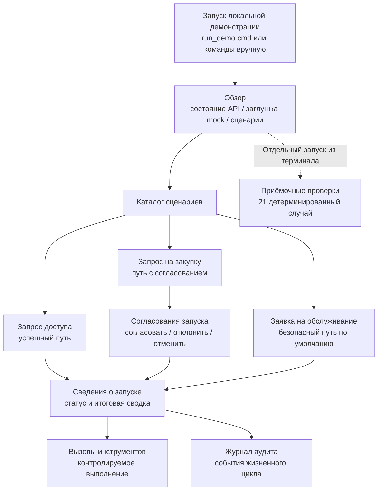

# Демонстрационный сценарий

## 1. Цель демонстрации

Это руководство помогает запустить Enterprise AI Tool Gateway локально и показать контролируемый жизненный цикл трёх сценариев на синтетических данных.

Основная модель управления:

```text
LLM предлагает решение.
Серверная часть проверяет его.
Инструменты выполняются через контролируемые границы.
Согласование ограничивает рискованные действия.
Журнал аудита сохраняет события жизненного цикла.
Веб-интерфейс показывает этот процесс через /api/v1.
```

Демонстрация показывает ответственность сервера за валидацию, вызовы инструментов, политику выполнения, согласования, аудит и чтение результатов через публичный API. Используются локальное приложение и синтетические данные; интеграций с реальными корпоративными системами нет.



## 2. Перед началом

Потребуются:

* локальная копия репозитория;
* Python ≥3.14 и `uv` для серверной части;
* Node.js и npm для веб-интерфейса;
* установленные зависимости веб-интерфейса, если это первый запуск.

По умолчанию используется заглушка `mock`. Ключи реального поставщика модели не требуются для API, веб-интерфейса и приёмочных проверок.

Если зависимости веб-интерфейса отсутствуют, установите их один раз:

```bash
cd frontend
npm install
cd ..
```

Самый быстрый запуск на Windows:

```text
run_demo.cmd
```

Программа запуска не устанавливает зависимости автоматически. Она запускает оба локальных сервиса, ожидает готовности серверной части, проверяет маркер веб-интерфейса и проксирование API, затем открывает обзор. Логи обоих сервисов видны в одном окне и сохраняются в файлах отдельного экземпляра. `Ctrl+C` запускает штатную остановку; закрытие окна завершает всё дерево процессов этого экземпляра. `Q` — дополнительный способ остановки. Уже готовые сервисы переиспользуются: программа не становится их владельцем и не останавливает их при своём завершении. Для работы в отдельных терминалах используйте команды ниже.

## 3. Запуск серверной части

Из корня репозитория запустите FastAPI:

```bash
uv run uvicorn enterprise_ai_tool_gateway.api.http.app:app --reload
```

Версия локального API доступна по префиксу `/api/v1`.

Проверьте доступность и сведения о возможностях:

```text
GET http://127.0.0.1:8000/api/v1/health
GET http://127.0.0.1:8000/api/v1/capabilities
```

Ожидаемый ответ проверки доступности:

```json
{"status": "ok"}
```

Корневой URL сервера может возвращать 404:

```text
GET http://127.0.0.1:8000/
```

Это ожидаемо: серверная часть не отдаёт главную страницу веб-интерфейса.

## 4. Запуск веб-интерфейса

Во втором терминале запустите Vite:

```bash
cd frontend
npm run dev -- --host 127.0.0.1 --port 5173
```

Откройте веб-интерфейс:

```text
http://127.0.0.1:5173/dashboard
```

Клиент API по умолчанию обращается к `/api/v1`. Vite проксирует `/api` на `http://localhost:8000`, поэтому запросы браузера к `/api/v1/...` достигают маршрутов FastAPI `/api/v1`.

## 5. Первые экраны: обзор и настройки

Если язык ещё не сохранён в браузере, интерфейс открывается на русском. Через переключатель «Язык интерфейса» выполните `RU → EN → RU` без перезагрузки страницы. Значения форм, поле открытия запуска, выбранные запуск и согласование, а также последний результат должны сохраниться.

Далее используются русские названия интерфейса. Для сопоставления с английскими скриншотами в README: «Обзор» — Dashboard, «Сведения о запуске» — Run Detail, «Настройки» — Settings, «Результат отправки» — Submit Result, «Ручная проверка» — Manual review. Видео в README записано на русском. Переключатель меняет представление интерфейса; исходные JSON, UUID, ключи запросов, значения перечислений и статусов, а также текст, полученный от серверной части, остаются без перевода.

На `/dashboard` проверьте:

* «Состояние API» — `ok`;
* «Режим провайдера» — `mock`;
* «Выбор модели» — «выключен»;
* «Доступные сценарии» — три сценария, поддерживаемых сервером;
* «Известные запуски» и «Ожидают согласования» учитывают только ID запусков, известных этой сессии браузера.

Откройте `/settings`, страницу «Настройки / состояние API», и проверьте:

* «Базовый URL API» — `/api/v1`, если адрес не переопределён переменной окружения;
* «Состояние» — `ok`;
* «Режим провайдера» — `mock`;
* «Выбор модели» — «выключен»;
* в JSON возможностей указаны `model_selection.enabled: false`, `active_profile: "mock"` и `available_profiles: ["mock"]`.

Веб-интерфейс — локальная консоль работы с серверным API. Он не выполняет инструменты, не оценивает политику выполнения, не вызывает поставщиков LLM напрямую и не читает базу SQLite.

## 6. Сценарий A — успешный запрос доступа

Откройте:

```text
http://127.0.0.1:5173/workflows/access
```

Используйте проверенные значения по умолчанию. Английский текст входных данных сохраняется намеренно, независимо от языка интерфейса.

| Поле | Значение |
| --- | --- |
| ID пользователя | `user-1` |
| Текст запроса | `Need access to CRM.` |
| ID сотрудника | `emp-001` |
| ID системы | `crm` |
| Уровень доступа | `READ` |
| Срок, дней | `30` |
| Режим согласования | `HIGH_RISK_ONLY` |
| Обоснование | `Need access for routine work.` |

Нажмите «Отправить запрос доступа».

Ожидаемый контролируемый результат:

* статус `COMPLETED` — «Завершён»;
* «Требует согласования» — «нет»;
* черновик создаётся серверным инструментом в пределах разрешённого выполнения.

Из результата отправки откройте ссылки:

* «Сведения о запуске»;
* «Вызовы инструментов»;
* «Журнал аудита».

В сведениях о запуске проверьте результат, итоговую сводку, риск и количество записей. Во вызовах инструментов посмотрите проверки доступа и создание черновика: записи содержат статусы и JSON данных с маскированием чувствительных значений. В журнале аудита должны быть события создания запуска, проверки политики выполнения и завершения.

Этот путь показывает последовательность: поставщик модели предлагает структурированное решение по доступу, сервер проверяет его, инструменты чтения выполняются через зарегистрированные границы, политика разрешает создание черновика, а аудит сохраняет события.

Если изменить «Уровень доступа» на `ADMIN`, сценарий должен перейти к обязательному согласованию вместо немедленного завершения.

## 7. Сценарий B — закупка с согласованием

Откройте:

```text
http://127.0.0.1:5173/workflows/procurement
```

В форме со значениями по умолчанию измените три поля:

| Поле | Значение |
| --- | --- |
| ID позиции | `item-service` |
| Наименование | `Implementation services` |
| Ожидаемая сумма | `1500` |

Остальные значения оставьте исходными:

| Поле | Значение |
| --- | --- |
| ID пользователя | `user-1` |
| Текст запроса | `Need to buy equipment.` |
| ID инициатора | `req-001` |
| Количество | `1` |
| Валюта | `USD` |
| Центр затрат | `cc-ops` |
| Предпочтительный поставщик | `vendor-approved-001` |
| Режим согласования | `HIGH_RISK_ONLY` |
| Обоснование | `Need equipment.` |

Нажмите «Отправить запрос на закупку».

Демонстрационный API закупки принимает только валюту `USD`; другое значение возвращает HTTP 422. При принятии решения поле «Решение принял» должно оставаться непустым: пустая строка или строка из пробелов также отклоняется с HTTP 422.

Ожидаемый начальный результат:

* статус `WAITING_FOR_APPROVAL` — «Требуется согласование»;
* «Требует согласования» — «да»;
* возвращается согласование, ожидающее решения;
* действие создания черновика закупки ещё не выполнено.

Откройте:

```text
/runs/{run_id}/approvals
```

Выберите согласование, ожидающее решения. Поле «Решение принял» по умолчанию содержит `manager-001`. Это демонстрационная подпись оператора: аутентификации и проверки его роли по RBAC в прототипе нет.

Выберите одну ветку:

* «Согласовать» — принять положительное решение и завершить запуск;
* «Отклонить» — отклонить запуск без черновика;
* «Отменить» — отменить согласование и отклонить запуск без черновика.

После согласования обновите или откройте сведения о запуске: ожидается конечный статус `COMPLETED`. После отклонения или отмены ожидается `REJECTED`.

Проверьте вызовы инструментов:

* до согласования действие создания черновика не должно успешно выполняться;
* после согласования оно может успешно выполниться и создать демонстрационный черновик;
* после отклонения или отмены черновик не создаётся.

В журнале аудита проверьте запрос согласования, принятое решение и итоговые события. Сценарий показывает, что закупка на большую сумму не создаёт черновик до разрешения, а решение обрабатывается серверным API.

## 8. Сценарий C — безопасный путь обслуживания

Откройте:

```text
http://127.0.0.1:5173/workflows/maintenance
```

Используйте проверенные значения по умолчанию:

| Поле | Значение |
| --- | --- |
| ID пользователя | `user-1` |
| Текст запроса | `Routine inspection for Cooling pump 1.` |
| ID инициатора | `maint-req-001` |
| ID актива | `asset-pump-001` |
| Название актива | `Cooling pump 1` |
| Местоположение | `Plant A` |
| Зафиксированная критичность | `LOW` |
| Режим согласования | `HIGH_RISK_ONLY` |
| Описание проблемы | `Routine inspection needed.` |
| Есть угроза безопасности | Флажок снят |

Нажмите «Отправить заявку на обслуживание».

Ожидаемый результат:

* статус `COMPLETED` — «Завершён»;
* согласования, ожидающего решения, нет;
* создаётся демонстрационный черновик заказ-наряда;
* записи инструментов и аудита показывают путь обслуживания низкой критичности.

Используйте значения критичности в верхнем регистре из списка интерфейса:

```text
LOW
MEDIUM
HIGH
CRITICAL
```

Сервер проверяет допустимые значения `MaintenanceSeverity`. Значения в нижнем регистре или неизвестные значения в запросах API не относятся к описанному пути интерфейса по умолчанию.

При экспериментах с произвольным текстом заявки может появиться `FAILED_TOOL`. Показывайте его как контролируемую серверную ошибку, а не успешное обслуживание или сбой интерфейса. Для воспроизводимой демонстрации используйте значения из таблицы и изучайте вызовы инструментов и журнал аудита.

## 9. Просмотр отдельного запуска

Страницы веб-интерфейса относятся к одному запуску:

| Страница | Назначение |
| --- | --- |
| `/runs/{run_id}` | Сведения о запуске: контролируемый результат, итоговая сводка, метаданные, количество записей и JSON запуска. |
| `/runs/{run_id}/approvals` | Согласования запуска: ожидающие и окончательные согласования; действия доступны, пока решение не принято. |
| `/runs/{run_id}/tool-calls` | Вызовы инструментов запуска: имена, типы, статусы, связи с согласованиями, безопасные сообщения об ошибках и входные/выходные данные с маскированием. |
| `/runs/{run_id}/audit` | Журнал аудита запуска: хронология событий, инициаторы и JSON выбранного события. |

Страница «Запуски агента» — индекс ID, известных локальной сессии браузера. Общего серверного маршрута списка запусков нет. Интерфейс различает полные, частичные, недоступные и устаревшие данные, включая ошибки чтения. Частичный или неудачный ответ не представляется достоверным пустым или актуальным результатом; данные и действия страницы принадлежат только текущему ID запуска или согласования.

Чтобы проверить существующий запуск, вставьте его `run_id` в поле «Открыть запуск» на обзоре или в настройках. Если сервер знает запуск, интерфейс добавит ID в локальный индекс и откроет сведения о нём.

## 10. Запуск приёмочных проверок

Запустите детерминированный набор проверок API:

```bash
uv run python scripts/run_eval.py
uv run python scripts/run_eval.py --format json
```

При успешном прохождении ожидается:

```text
21/21 passed
```

Соответствующая строка текстового отчёта:

```text
Total: 21  Passed: 21  Failed: 0
```

Это пример ожидаемого успешного результата, а не отчёт о последнем запуске. Проверки охватывают контролируемые статусы, обязательное согласование, отсутствие черновика до разрешения, маршруты чтения, аудит, коды причин, ожидания по маскированию и обработку ошибок валидации.

Приёмочные проверки не подтверждают безопасность промышленной эксплуатации, качество реального поставщика модели, реальные корпоративные интеграции, аутентификацию, RBAC, изоляцию арендаторов, масштабируемость, полное сквозное тестирование интерфейса или готовность промышленного мониторинга.

## 11. На что обратить внимание при показе

* Сервер управляет жизненным циклом от отправки сценария до конечного статуса запуска.
* Рискованные изменяющие состояние действия защищены согласованием.
* Наличие или отсутствие черновика соответствует этапу согласования и решению.
* Видны зарегистрированные имена инструментов, статусы и безопасные сообщения об ошибках.
* Журнал аудита содержит события выбранного запуска.
* В публичных данных API и интерфейса маскируются чувствительные значения.
* Контролируемые остановки и ошибки показаны явно: `NEEDS_USER_INPUT`, `NEEDS_MANUAL_REVIEW`, `REJECTED`, `FAILED_VALIDATION`, `FAILED_TOOL`, `FAILED_PROVIDER`.
* Веб-интерфейс на React отображает результаты сервера через `/api/v1`.

## 12. Решение проблем

### Корневой путь сервера возвращает 404

Для корневого пути `/` это ожидаемо. Используйте `/api/v1/health`, `/api/v1/capabilities` или страницу обзора веб-интерфейса.

### Веб-интерфейс не может подключиться к API

Убедитесь, что сервер работает на порту 8000, а веб-интерфейс запущен через Vite. Клиент вызывает `/api/v1`, а Vite проксирует `/api` на `http://localhost:8000`.

### Программа запуска сообщает о конфликте на порту 5173

Сервис не прошёл проверку точного маркера Gateway и проксируемого `/api/v1/health`. Произвольный HTTP-сервер с ответом 2xx/3xx, как и сервер с маркером, но без рабочего прокси API, не переиспользуется и не останавливается. Освободите порт или запустите корректный веб-интерфейс Gateway.

### Остановка и логи программы запуска

Метаданные экземпляра находятся в `.runtime/instances/<instance-id>/`, логи — в `.runtime/logs/<instance-id>/`. `Ctrl+C`, закрытие окна и `Q` останавливают сервисы текущего экземпляра; переиспользованные сервисы сохраняют своего владельца.

Для очистки старых подтверждённых экземпляров выполните `powershell -NoProfile -ExecutionPolicy Bypass -File scripts/demo/stop_demo.ps1`. Записи, принадлежность которых не удалось подтвердить, остаются нетронутыми для диагностики.

### В Windows нет `npm` в PATH

При необходимости используйте полный путь:

```text
C:\Program Files\nodejs\npm.cmd
```

### Чёрный экран

Проверьте консоль браузера и терминал Vite. Для замороженного прототипа описанные пути по умолчанию не должны приводить к пустому экрану.

### Обслуживание возвращает FAILED_TOOL на произвольных данных

Это контролируемая ошибка серверной части. Для воспроизводимого показа используйте значения сценария C. Изучите вызовы инструментов и журнал аудита: такая ошибка не означает сбой интерфейса и не является успешным результатом обслуживания.

### Нужны ли ключи реального поставщика модели

Для демонстрации по умолчанию они не требуются: используется заглушка `mock`.

## 13. Ограничения демонстрации

* Только локальное демонстрационное приложение.
* Синтетические данные сценариев.
* Детерминированная заглушка `mock` по умолчанию.
* Нет аутентификации, RBAC и изоляции арендаторов.
* Нет реальных IAM, ERP, 1С, Jira, CRM, CMMS, EAM и других корпоративных интеграций.
* Нет выбора поставщика LLM и модели.
* Нет промышленного развёртывания.
* Нет общего серверного списка запусков и глобального поиска аудита.
* Полное сквозное тестирование интерфейса не заявляется.

Ценность прототипа — модель контролируемого выполнения: серверная валидация, границы инструментов, политика выполнения, согласования, журнал аудита и публичное чтение записей отдельного запуска.
