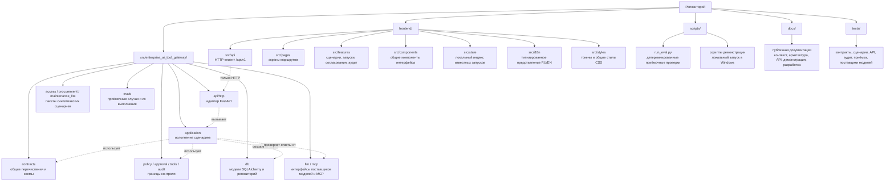

# Карта проекта

## 1. Обзор репозитория

`enterprise-ai-tool-gateway` содержит локальный демонстрационный прототип Enterprise AI Tool Gateway. В репозитории находятся серверная часть шлюза на Python, адаптер FastAPI `/api/v1`, детерминированные приёмочные проверки API, независимый веб-интерфейс на React/Vite и итоговая документация проекта.

Сервер демонстрирует контролируемое использование инструментов, предложенных LLM: ответы поставщика модели проверяются по серверным контрактам, инструменты выполняются только через предусмотренные интерфейсы, создание черновиков проходит проверки политики выполнения и согласования, а записи каждого запуска сохраняются для последующего чтения.

Верхнеуровневые области:

| Путь | Зона ответственности |
| --- | --- |
| `src/enterprise_ai_tool_gateway/` | Серверный пакет Python: контракты, исполнение сценариев, инструменты, политика выполнения, согласования, журнал аудита, хранение, поставщики моделей, API и поддержка приёмочных проверок. |
| `frontend/` | Независимый локальный веб-интерфейс на React, TypeScript и Vite. |
| `tests/` | Детерминированные автономные тесты Python для серверной части, API, приёмочных проверок и границ ответственности. |
| `scripts/` | Командные точки входа: детерминированные приёмочные проверки, безопасный запуск локальной демонстрации и явно вызываемые диагностические проверки. |
| `docs/` | Публичная документация проекта, включая основные документы с устойчивыми сведениями о проекте. |
| `pyproject.toml` | Метаданные пакета Python, требование Python `>=3.14`, зависимости приложения и настройки инструментов. |



## 2. Карта серверного пакета

Основные пакеты в `src/enterprise_ai_tool_gateway/`:

| Пакет | Зона ответственности |
| --- | --- |
| `contracts/` | Общие перечисления и контракты Pydantic для типов запросов, предметных шаблонов, запусков, решений LLM, инструментов, согласований и событий аудита. |
| `workflow/` | Чистые вспомогательные функции переходов между событиями и статусами сценария для `AgentRunStatus`. |
| `llm/` | Интерфейс поставщика модели, детерминированные заглушки, разбор структурированных ответов, безопасные ошибки, необязательная поддержка GigaChat и отложенные экспериментальные заготовки YandexGPT. |
| `mcp/` | Необязательный локальный интерфейс в стиле MCP и диагностические утилиты; не заменяет `ToolRegistry`. |
| `tools/` | Общий механизм `ToolDefinition`, `ToolRegistry` и `ToolExecutor` с проверкой входных и выходных данных через Pydantic. |
| `policy/` | Контракты запросов и решений политики выполнения, а также стандартная оценка политики для инструментов. |
| `approval/` | Базовые требования согласования и решения по ним. |
| `audit/` | Создание событий аудита и рекурсивное маскирование содержимого. |
| `db/` | Асинхронные модели SQLAlchemy, создание схемы, фабрика сессий и фасад репозитория для локального хранения в SQLite. |
| `demo_domain/` | Детерминированные синтетические данные доступа, закупок и обслуживания для демонстрационных инструментов. |
| `access/` | Демонстрационные схемы сценария доступа и определения его синтетических инструментов. |
| `procurement/` | Демонстрационные схемы сценария закупок и определения его синтетических инструментов. |
| `maintenance_lite/` | Демонстрационные схемы упрощённого сценария обслуживания и определения его синтетических инструментов. |
| `application/` | Исполнение сценариев, общие вспомогательные функции и DTO прикладного слоя. |
| `api/http/` | Входной адаптер FastAPI: маршруты, схемы API, преобразования данных, зависимости и нормализация ошибок. |
| `evals/` | Детерминированные приёмочные случаи API, подмена зависимостей, выполнение проверок и модели результатов. |

## 3. Контракты

`src/enterprise_ai_tool_gateway/contracts/` определяет общие структуры данных серверной части.

| Файл | Зона ответственности |
| --- | --- |
| `enums.py` | Стабильные строковые перечисления для типов запросов, предметных шаблонов, статусов запуска, уровней риска, типов инструментов, статусов вызова инструментов и согласований, решений политики, режимов согласования, событий аудита и имён поставщиков моделей. |
| `schemas.py` | Контракты Pydantic для запусков агента, предложенных вызовов инструментов, решений LLM, выполненных вызовов, согласований и событий аудита. |
| `__init__.py` | Публичный экспорт контрактов. |

Основные группы контрактов:

| Область | Примеры |
| --- | --- |
| Классификация запроса и предметной области | `RequestType`, `DomainTemplate`, `LLMDecisionPayload`. |
| Жизненный цикл запуска | `AgentRunCreate`, `AgentRunRead`, `AgentRunStatus`. |
| Интерфейс инструментов | `ProposedToolCall`, `ToolCallCreate`, `ToolCallRead`, `ToolType`, `ToolCallStatus`. |
| Согласования и политика выполнения | `ApprovalCreate`, `ApprovalRead`, `ApprovalMode`, `ApprovalStatus`, `PolicyDecisionStatus`. |
| Аудит | `AuditEventCreate`, `AuditEventRead`, `AuditEventType`. |

Граница ответственности: контракты задают общие структуры данных и наборы значений перечислений. Они не управляют исполнением сценариев, решениями политики, вызовами поставщиков моделей, запросами к базе данных, маршрутизацией FastAPI или поведением веб-интерфейса.

## 4. Исполнение сценариев в прикладном слое

`src/enterprise_ai_tool_gateway/application/` координирует серверное исполнение реализованных демонстрационных сценариев.

| Файл | Зона ответственности |
| --- | --- |
| `access_runtime.py` | Исполнение `ACCESS_REQUEST`: создаёт запуски, вызывает поставщика модели, проверяет решения по доступу, выполняет инструменты, применяет политику, создаёт и обрабатывает согласования, сохраняет записи. |
| `procurement_runtime.py` | Исполнение `PROCUREMENT_REQUEST`: координирует синтетические проверки инициатора, поставщика, каталога, бюджета и дубликатов, а также создание черновика заявки на закупку. |
| `maintenance_lite_runtime.py` | Исполнение `MAINTENANCE_REQUEST`: координирует синтетические проверки инициатора, оборудования, серьёзности проблемы, дубликатов и политики, а также создание черновика наряда на работы. |
| `demo_workflow.py` | Общая механика: поиск недостающих полей, проверка предложенных инструментов, выполнение и сохранение вызовов, сохранение аудита, формирование запросов политики, обработка согласований и сбор записей запуска. |
| `dtos.py` | DTO запросов и результатов прикладного слоя для отправки заявки и обработки решения по согласованию. |

Прикладной слой принимает решения по сценарию и координирует выполнение пользовательского запроса. Он определяет, какие контракты, инструменты, проверки политики, согласования, события аудита и операции репозитория используются в отдельном запуске.

Границы ответственности:

* Маршруты API вызывают прикладной слой, но не содержат логику сценариев.
* Прикладной слой проверяет решения поставщика модели до принятия любого предложенного плана инструментов.
* Прикладной слой выполняет инструменты через реестр и исполнитель.
* Прикладной слой может сохранять записи через `GatewayRepository`, но репозиторий не определяет исход сценария.

## 5. Пакеты предметных сценариев

Эти пакеты содержат только синтетические демонстрационные схемы и инструменты своих сценариев.

| Пакет | Зона ответственности |
| --- | --- |
| `access/` | Схемы доступа, проверки сотрудника, системы, политики доступа и заявки, а также `create_access_request_draft`. |
| `procurement/` | Схемы закупок, проверки инициатора, поставщика, каталога, бюджета и дубликатов, проверка политики закупок и `create_purchase_request_draft`. |
| `maintenance_lite/` | Схемы обслуживания, проверки инициатора, оборудования, серьёзности проблемы и дубликатов, проверка политики обслуживания и `create_work_order_draft`. |

Пакеты регистрируют объекты `ToolDefinition` в `ToolRegistry`. Их изменяющие состояние инструменты создают только синтетические черновики. Реальных интеграций с IAM, ERP, системами закупок, CMMS, EAM или обслуживания здесь нет.

`src/enterprise_ai_tool_gateway/demo_domain/` содержит детерминированные демонстрационные данные в памяти для этих инструментов. Он представляет будущие внешние источники, но не реализует интеграции с корпоративными системами.

Границы ответственности:

* Предметные пакеты не управляют маршрутизацией API, выбором поставщика модели, обработкой согласований, правилами хранения, переходами состояния сценария или HTTP.
* Предметные инструменты остаются зарегистрированными серверными инструментами; веб-интерфейс и LLM не вызывают их напрямую.
* Отдельные предметные таблицы базы данных для синтетических сценариев не реализованы.

## 6. Слой API

`src/enterprise_ai_tool_gateway/api/http/` — адаптер FastAPI для `/api/v1`.

| Область | Зона ответственности |
| --- | --- |
| `app.py` | Фабрика приложения, настройка жизненного цикла, создание схемы SQLite и сборка маршрутизатора `/api/v1`. |
| `routes/` | HTTP-маршруты проверки работоспособности, возможностей API, отправки заявок, обработки согласований и чтения записей отдельных запусков. |
| `schemas/` | DTO запросов и ответов публичного HTTP API. |
| `mappers.py` | Преобразования между DTO API, DTO прикладного слоя и публичными DTO ответов с маскированием чувствительных данных. |
| `dependencies.py` | Сессия БД на время запроса, репозиторий и подключение зависимостей прикладного слоя. |
| `errors.py` | Вспомогательные функции HTTP-ошибок и общая обработка исключений. |

Реализованные локальные маршруты API:

| Метод и путь | Назначение |
| --- | --- |
| `GET /api/v1/health` | Проверить работоспособность локального API. |
| `GET /api/v1/capabilities` | Получить поддерживаемые типы запросов, режимы согласования и сведения об отключённом выборе модели. |
| `POST /api/v1/access-requests` | Отправить заявку на доступ. |
| `POST /api/v1/procurement-requests` | Отправить заявку на закупку. |
| `POST /api/v1/maintenance-requests` | Отправить заявку на обслуживание. |
| `POST /api/v1/approvals/{approval_id}/resolve` | Принять решение по ожидающему согласованию отдельного запуска. |
| `GET /api/v1/runs/{run_id}` | Прочитать сведения о запуске и связанные записи. |
| `GET /api/v1/runs/{run_id}/tool-calls` | Прочитать вызовы инструментов запуска. |
| `GET /api/v1/runs/{run_id}/approvals` | Прочитать согласования запуска. |
| `GET /api/v1/runs/{run_id}/audit-events` | Прочитать события аудита запуска. |

Границы ответственности:

* API — входной адаптер; бизнес-логика находится в прикладном слое.
* Маршруты API преобразуют запросы и ответы, подключают зависимости.
* Маршруты API не выполняют инструменты, не оценивают политику, не принимают решения по согласованию и не меняют состояние сценария вне вызовов прикладного слоя.
* Публичные ответы API проходят через безопасные преобразования и проекции данных.

## 7. Политика выполнения, согласования, инструменты и аудит

Механизмы контроля разделены между специализированными пакетами.

| Пакет | Зона ответственности |
| --- | --- |
| `policy/` | `PolicyCheckRequest`, `PolicyDecision` и `evaluate_default_tool_policy`. Стандартная политика разрешает выполнение, требует согласования или ручной проверки в зависимости от типа инструмента, риска, режима согласования и метаданных инструмента. |
| `approval/` | `ApprovalRequirement`, `ApprovalDecision`, проверка базовых условий согласования и вспомогательные функции определения окончательного или разрешающего решения. |
| `tools/` | `ToolRegistry`, `ToolDefinition`, `ToolExecutor`, ошибки повторной регистрации и неизвестного инструмента, проверка входных и выходных данных через Pydantic и разрешение на выполнение изменяющих состояние действий. |
| `audit/` | `create_audit_event`, рекурсивное маскирование содержимого, выявление чувствительных ключей и значений, ограничение длины строк. |

Реализованные меры контроля:

* `ToolRegistry` — основной внутренний реестр и интерфейс инструментов.
* `ToolExecutor` блокирует инструменты, которые не ограничиваются чтением, если выполнение явно не разрешено.
* Неизвестные инструменты приводят к ошибке проверки; прикладной слой не угадывает и не исправляет их имена.
* Стандартная политика задаёт обязательный минимум ограничений для `AUTO_APPROVE`: критический риск требует ручной проверки, изменяющие состояние вызовы с высоким риском всё равно требуют согласования, как и инструменты, для которых согласование обязательно по умолчанию.
* Перед ответом API входные и выходные данные инструментов, а также свободные текстовые поля согласований проходят через функции маскирования.
* Запрос решения по согласованию требует непустой `decided_by`. Условное обновление в хранилище позволяет только одному запросу перевести согласование из ожидающего состояния в окончательное; проигравший конкурентный запрос получает контролируемый `409 state_conflict` до последующих изменений окончательного состояния.
* Содержимое события аудита рекурсивно маскируется по признакам чувствительных данных до сохранения, включая уверенно распознаваемые присваивания учётных данных в кавычках или сериализованном виде. Это не универсальная система предотвращения утечек данных (DLP).

Границы ответственности:

* `policy/` определяет только решения политики; не выполняет инструменты, не пишет в хранилище и не меняет состояние сценария.
* `approval/` определяет базовые сущности согласования; прикладной слой решает, как они влияют на запуск.
* `tools/` отвечает только за контролируемое выполнение инструментов; не управляет рассуждениями LLM, маршрутизацией HTTP или координацией сценариев.
* `audit/` создаёт контракты событий с замаскированными данными; не отвечает за долговременное хранение или отправку во внешние системы журналирования.

## 8. Хранение данных

`src/enterprise_ai_tool_gateway/db/` отвечает за локальное хранение в SQLite через асинхронный SQLAlchemy.

| Файл | Зона ответственности |
| --- | --- |
| `models.py` | Модели SQLAlchemy для запусков агента, решений LLM, вызовов инструментов, согласований и событий аудита. |
| `repository.py` | `GatewayRepository`, методы чтения и записи, преобразование моделей в контракты. |
| `session.py` | Вспомогательные фабрики асинхронных движков и сессий, настройка внешних ключей SQLite. |
| `bootstrap.py` | Создание схемы для локального API и тестов. |
| `base.py` | Декларативный базовый класс. |

Сохраняются:

* запуски агента;
* проверенные решения LLM;
* вызовы инструментов;
* согласования;
* события аудита.

Граница ответственности: `db/` сохраняет факты, выбранные прикладным слоем. Он не определяет политику, не разрешает выполнение инструментов, не проверяет смысл ответа поставщика модели, не выбирает общий исход сценария или правила публичного представления API. `GatewayRepository` отвечает только за узкий атомарный переход согласования из ожидающего состояния в окончательное, не позволяющий двум запросам одновременно получить право завершить согласование.

## 9. Интерфейсы поставщиков моделей и MCP

Код поставщиков моделей находится в `src/enterprise_ai_tool_gateway/llm/`.

| Файл | Зона ответственности |
| --- | --- |
| `base.py` | Интерфейс поставщика модели, контракты запроса и ответа решения, иерархия безопасных ошибок и защитные условия проверок реального поставщика. |
| `mock.py` | Детерминированная заглушка поставщика для стандартных тестов и локальной демонстрации. |
| `static.py` | Вспомогательные функции поставщика фиксированных решений для детерминированной демонстрации закупок и обслуживания. |
| `structured_output.py` | Извлечение JSON и разбор `LLMDecisionPayload` из исходного текста ответа поставщика. |
| `factory.py` | Создание поставщика по переменным окружения для поддерживаемых явно выбранных режимов. |
| `gigachat.py` | Необязательная ручная интеграция GigaChat: настройки, транспорт, формирование промпта и запроса, разбор ответа. |
| `yandex.py` | Отложенные настройки и экспериментальная заготовка YandexGPT; активной интеграции с исполнением сценариев нет. |

Границы ответственности:

* Поставщики моделей только предлагают структурированные решения.
* Ответ поставщика считается недоверенным, пока не разобран и не проверен по серверным контрактам.
* После проверки схемы прикладной слой дополнительно проверяет тип запроса, предметный шаблон и допустимые имена инструментов.
* Стандартные тесты и локальный API используют детерминированные заглушки и фиксированные решения.
* GigaChat подключается необязательно, вручную и с явными настройками; ошибка настройки реального поставщика не должна незаметно переключать систему на заглушку.
* OpenRouter и выбор YandexGPT для активного исполнения не реализованы.
* Маршрут возможностей API сообщает об отключённом выборе модели и активном профиле `mock`.

Код MCP находится в `src/enterprise_ai_tool_gateway/mcp/`.

| Файл | Зона ответственности |
| --- | --- |
| `boundary.py` | Клиентский интерфейс в стиле MCP, безопасные ошибки, типизированный демонстрационный инструмент статуса системы, извлечение и проверка результатов. |
| `server.py` | Вспомогательные функции локального демонстрационного сервера MCP для ручной диагностики. |

MCP — необязательный внешний интерфейс инструментов. Он не заменяет `ToolRegistry` как внутренний механизм контроля.

## 10. Приёмочные проверки и скрипты

Детерминированные приёмочные проверки находятся в `src/enterprise_ai_tool_gateway/evals/` и `scripts/run_eval.py`.

| Область | Зона ответственности |
| --- | --- |
| `evals/cases.py` | Набор из 21 приёмочного случая для исходов сценариев доступа, закупок и обслуживания. |
| `evals/runner.py` | Выполнение проверок через FastAPI API внутри процесса, обработка согласований, проверки чтения результатов и текстовое представление итогов. |
| `evals/providers.py` | Подмена зависимостей для детерминированных ответов поставщиков в приёмочных проверках. |
| `evals/results.py` | Модели результатов и сериализация. |
| `scripts/run_eval.py` | Командная оболочка детерминированных приёмочных проверок с текстовым выводом и JSON. |

Проверки обращаются к API с детерминированными поставщиками и локальными тестовыми базами SQLite. Они проверяют поведение шлюза и не являются оценкой качества LLM, сравнением поставщиков или тестированием внешних сервисов.

Утилиты ручной диагностики:

| Скрипт | Назначение |
| --- | --- |
| `scripts/mcp_smoke.py` | Ручная локальная проверка интерфейса MCP. |
| `scripts/manual_gigachat_smoke.py` | Явно вызываемая ручная проверка GigaChat; не входит в стандартные тесты. |

Точки запуска локальной демонстрации в Windows:

| Путь | Назначение |
| --- | --- |
| `run_demo.cmd` | Запуск `scripts/demo/run_demo.ps1` одним действием в Windows. |
| `scripts/demo/run_demo.ps1` | Запускает или безопасно использует уже работающие сервер и веб-интерфейс, создаёт отдельный экземпляр программы запуска, проверяет маркер веб-интерфейса и работоспособность API через прокси, открывает обзор. |
| `scripts/demo/runner_processes.cs` | Владение процессами через Windows Job Object, атомарное создание дочерних процессов, отмена из консоли и вывод в консоль и файл в реальном времени. |
| `scripts/demo/test_runner.ps1` | Локальные регрессионные проверки жизненного цикла в Windows: `Ctrl+C`, аварийное и раннее завершение, повторный запуск, использование готовых сервисов, конфликты и частичный запуск. |
| `scripts/demo/test_console_helper.cs` | Скрытая консоль только для тестов, сохранение точных дескрипторов процессов и изолированная отправка `Ctrl+C`. |
| `scripts/demo/runner_common.ps1` | Общие функции для неизменяемых метаданных, доказательства владения по PID, времени старта, команде и дереву процессов, а также очистки с отказом при невозможности проверки. |
| `scripts/demo/stop_demo.ps1` | Останавливает все и только проверенные деревья процессов, принадлежащие экземплярам программы запуска; старые общие PID-файлы и непроверяемые записи не дают права завершать процессы. |

## 11. Карта веб-интерфейса

`frontend/` — независимый клиент на React, TypeScript и Vite. Он не входит в пакет Python и не импортирует внутренние серверные модули.

| Путь | Зона ответственности |
| --- | --- |
| `frontend/package.json` | Метаданные пакета веб-интерфейса и команды `dev`, `typecheck`, `build`, `preview`. |
| `frontend/vite.config.ts` | Настройки React для Vite и локальное проксирование `/api` на `http://localhost:8000`. |
| `frontend/public/gateway-demo-marker.txt` | Статический маркер принадлежности проекту для программы запуска демонстрации; проверяется вместе с `/api/v1/health` через прокси. |
| `frontend/src/api/` | Все HTTP-запросы к серверному `/api/v1`, типы API для веб-интерфейса и обработка ошибок API. |
| `frontend/src/app/` | Оболочка приложения и маршруты React Router. |
| `frontend/src/i18n/` | Типизированный словарь RU/EN, управление языком и его сохранением, отображение канонических значений. |
| `frontend/src/pages/` | Экраны обзора, каталога и отправки заявок, сведений о запуске, его согласований, вызовов инструментов и аудита, а также согласований текущей сессии и настроек. |
| `frontend/src/features/` | Модули сценариев, согласований, запусков, вызовов инструментов, аудита, возможностей и состояния API. |
| `frontend/src/components/` | Общие компоненты разметки, обратной связи, данных, форм и статусов. |
| `frontend/src/state/` | Индекс известных запусков и выбранный запуск, хранящиеся в браузере. |
| `frontend/src/styles/` | Токены CSS и общие стили. |
| `frontend/src/types/` | Общие локальные типы TypeScript веб-интерфейса, если присутствуют. |

Границы ответственности:

* `frontend/src/api/` отвечает за обмен данными с сервером.
* Типы веб-интерфейса отражают публичные данные API и не импортируют контракты Python.
* Известный и выбранный запуск, а также выбранный язык — вспомогательное состояние браузера. Ошибка хранилища не должна ломать приложение. Это не глобальный поиск на сервере и не производственная очередь.
* Сводное чтение не выдаёт частично доступные или недоступные данные за достоверный пустой результат. Данные запусков и согласований, черновики, элементы управления и асинхронные сообщения относятся только к текущему идентификатору сущности.
* RU/EN меняет только представление. При отсутствии сохранённого языка выбран RU; исходный JSON, идентификаторы, ключи JSON, канонические перечисления и текст сервера не переводятся.
* Веб-интерфейс отображает исходы, определённые сервером. Он не вызывает поставщиков моделей, не выполняет инструменты, не оценивает политику, не согласовывает действия локально и не читает базу SQLite.

## 12. Карта тестов

`tests/` содержит детерминированные тесты Python. Стандартные тесты выполняются автономно, без вызовов реальных поставщиков моделей и внешних корпоративных систем.

| Область тестирования | Основные файлы |
| --- | --- |
| Контракты | `test_contracts.py`. |
| Переходы состояния сценария | `test_workflow.py`. |
| Инструменты, реестр и исполнитель | `test_tools.py`, `test_access_tools.py`, `test_procurement_tools.py`, `test_maintenance_tools.py`. |
| Базовые сущности политики и согласования | `test_policy.py`, `test_approval.py`. |
| Исполнение сценариев в прикладном слое | `test_access_runtime.py`, `test_procurement_runtime.py`, `test_maintenance_runtime.py`, `test_demo_workflow_helpers.py`. |
| Маршруты API и публичные преобразования | `test_api_health_capabilities.py`, `test_api_workflows.py`, `test_api_approvals_runs.py`, `test_api_approval_concurrency.py`, `test_api_mappers.py`. |
| Аудит и маскирование | `test_audit.py`, а также тесты преобразований API и чтения публичных представлений. |
| Хранение данных | `test_db.py`. |
| Приёмочные проверки | `test_evals.py`. |
| Поставщики моделей и структурированный ответ | `test_llm_spike.py`, `test_structured_output.py`, `test_gigachat_provider.py`. |
| Интерфейс MCP | `test_mcp_boundary.py`, `test_mcp_spike.py`. |
| Границы импортов | `test_import_boundaries.py`. |

Проверки веб-интерфейса не входят в набор тестов Python. Его пакет проверяется командами npm:

```bash
cd frontend
npm run typecheck
npm run build
```

## 13. Карта документации

Основная документация с устойчивыми сведениями о проекте находится в `docs/` и корне репозитория:

| Документ | Состояние | Зона ответственности |
| --- | --- | --- |
| `README.md` | написан | Публичное краткое руководство, локальный запуск API и веб-интерфейса, команды проверки. |
| `docs/PROJECT_CONTEXT.md` | написан | Границы прототипа, реализованные сценарии, меры контроля и сознательно исключённые возможности. |
| `docs/ARCHITECTURE.md` | написан | Архитектура системы, жизненный цикл, границы ответственности, модель ошибок и ограничения. |
| `docs/PROJECT_MAP.md` | этот документ | Структура репозитория, ответственность пакетов, точки входа и правила разделения слоёв. |
| `docs/API_AND_EVALS.md` | написан | Публичный API, контролируемые исходы, маскирование данных и детерминированные приёмочные проверки. |
| `docs/DEMO_WALKTHROUGH.md` | написан | Пошаговая локальная демонстрация серверной части, веб-интерфейса и приёмочных проверок. |
| `docs/DEVELOPMENT_GUIDE.md` | написан | Подготовка окружения, проверки, ручная диагностика и безопасный порядок разработки. |

Дополнительные документы:

| Документ | Зона ответственности |
| --- | --- |
| `docs/LLM_PROVIDER_POLICY.md` | Политика поставщиков моделей и вызова инструментов, защитные ограничения для реальных поставщиков. |
| `docs/DEVELOPMENT_CHECKLIST.md` | Текущий чеклист разработки и проверок. |

Границы документации:

* Публичные документы точно описывают реализованный локальный демонстрационный прототип.
* Локальные задания, отчёты, планы и файлы различий в игнорируемых рабочих каталогах не являются основными публичными документами проекта.
* Документация не должна заявлять готовность к промышленной эксплуатации и развёртыванию, реальные корпоративные интеграции, аутентификацию, RBAC, арендаторов, выбор поставщика или модели, конструктор сценариев или редактор политик, если они фактически не реализованы и не согласованы.

## 14. Правила импортов и разделения ответственности

Основные правила:

* Веб-интерфейс не импортирует внутренние модули серверной части Python.
* Маршруты API остаются тонкими входными адаптерами `/api/v1`.
* Прикладной слой координирует исполнение и принимает решения по сценарию.
* Контракты не зависят от прикладного слоя, маршрутов API, реализаций поставщиков моделей или хранилища.
* База данных и репозиторий не принимают решений по сценарию или политике и не разрешают выполнение инструментов.
* Инструменты выполняются только через `ToolRegistry` / `ToolExecutor` или явно ограниченный интерфейс MCP либо аналогичный ему.
* Ответ поставщика модели разбирается и проверяется до использования прикладным слоем.
* Проверка в прикладном слое отклоняет несовпадающие типы запросов и предметные шаблоны, а также неизвестные или недопустимые предложения инструментов.
* Изменяющие состояние инструменты требуют проверки политики.
* Изменяющие состояние инструменты с риском или обязательным согласованием по умолчанию требуют согласования перед созданием черновика.
* Публичные ответы API используют безопасные проекции и маскирование данных инструментов и свободных текстовых полей согласований.
* MCP необязателен и не заменяет `ToolRegistry` как основной внутренний механизм контроля инструментов.
* Проверки реальных поставщиков моделей остаются явно вызываемыми, ручными, требуют настройки и не входят в стандартный запуск pytest.

Практическое направление использования слоёв:

```text
contracts
  -> workflow / tools / policy / approval / audit / db
  -> пакеты предметных сценариев
  -> application (исполнение сценариев)
  -> api/http
  -> frontend (только через HTTP)
```

Стрелки показывают порядок использования нижних слоёв верхними. Они не разрешают нижним слоям вызывать код API, веб-интерфейса или прикладного слоя.

## 15. Игнорируемые, временные и сгенерированные файлы

Локальные и игнорируемые файлы:

| Файл или каталог | Обращение с ним |
| --- | --- |
| `frontend/node_modules/` | Игнорируемый результат установки зависимостей. |
| `frontend/dist/` | Игнорируемый результат сборки Vite. |
| `frontend/.vite/` | Игнорируемый кэш Vite. |
| `.venv/`, `.pytest_cache/`, `.ruff_cache/`, `.pyright/`, `__pycache__/` | Игнорируемые локальные кэши Python и инструментов. |
| `.runtime/instances/<instance-id>/` | Метаданные отдельного экземпляра программы запуска; записи сервисов создаются только для запущенных им процессов. |
| `.runtime/logs/<instance-id>/` | Журналы сервера и веб-интерфейса отдельного экземпляра; могут оставаться после очистки для диагностики. |
| `/data/`, `*.db`, `*.sqlite`, `*.sqlite3`, `*.log` | Игнорируемые локальные данные и журналы приложения. |
| `.env`, `.env.*` кроме `.env.example` | Игнорируемые локальные настройки окружения и файлы с секретами. |
| `*.diff`, `*.patch` | Игнорируемые локальные файлы различий и материалы проверки. |
| локальные задания, отчёты и планы в игнорируемых рабочих каталогах | Временные рабочие материалы; не считаются основными публичными документами проекта. |

Не коммитьте секреты, учётные данные, локальные базы данных, каталоги установленных зависимостей, результаты сборки или временные задания, отчёты и файлы различий.
